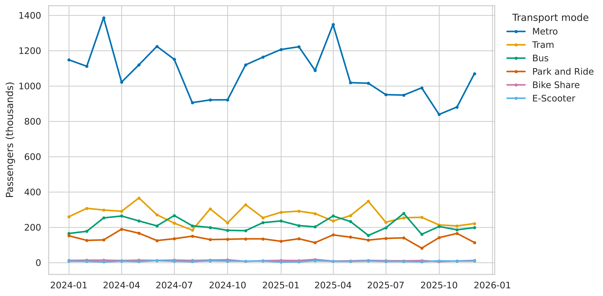
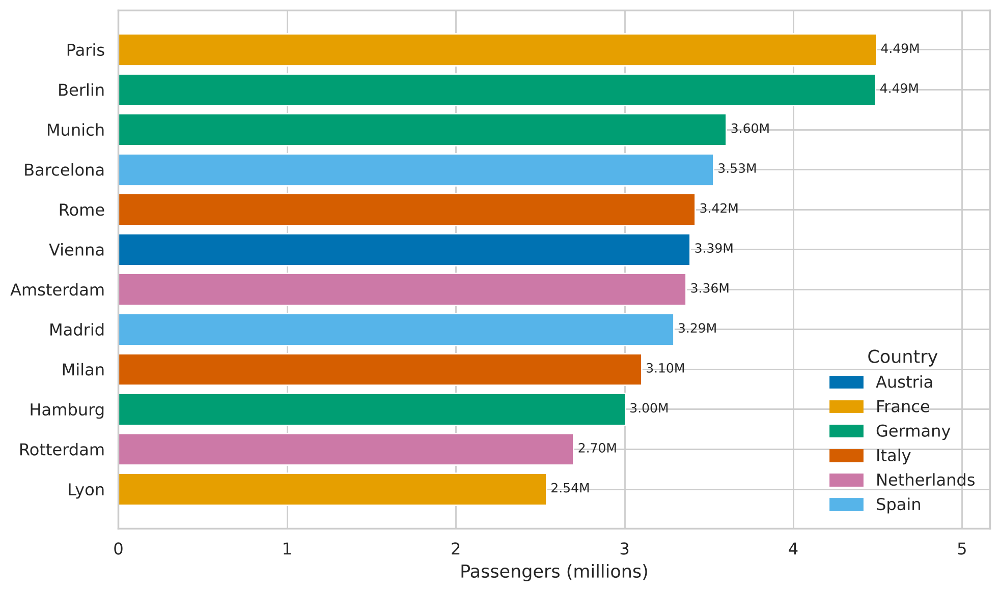
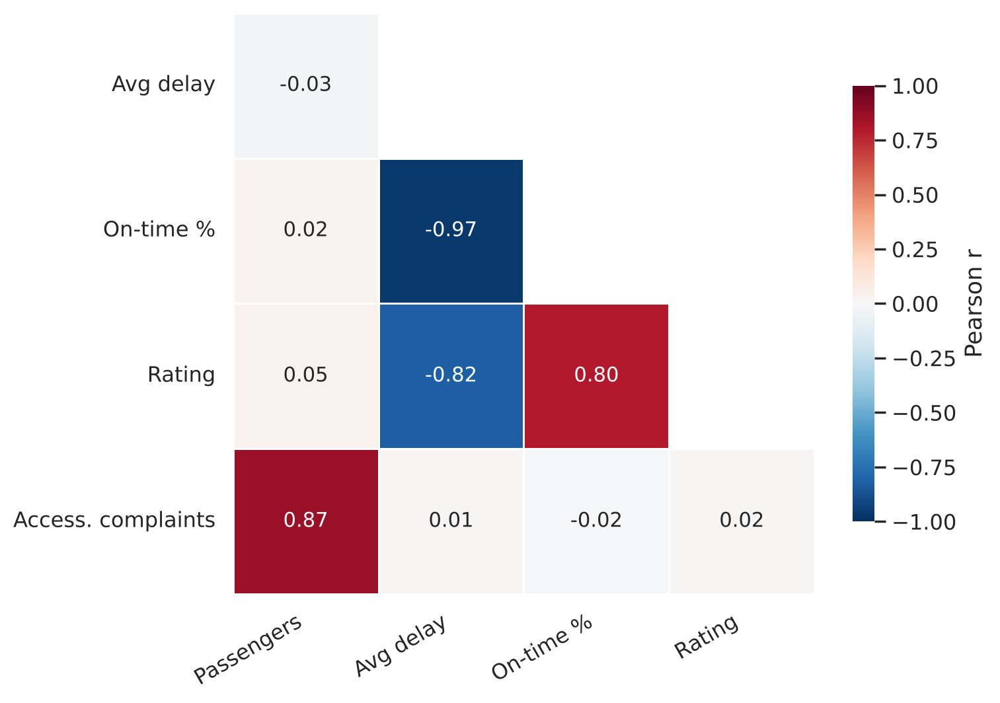
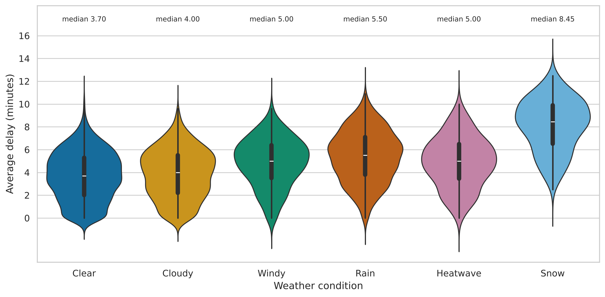
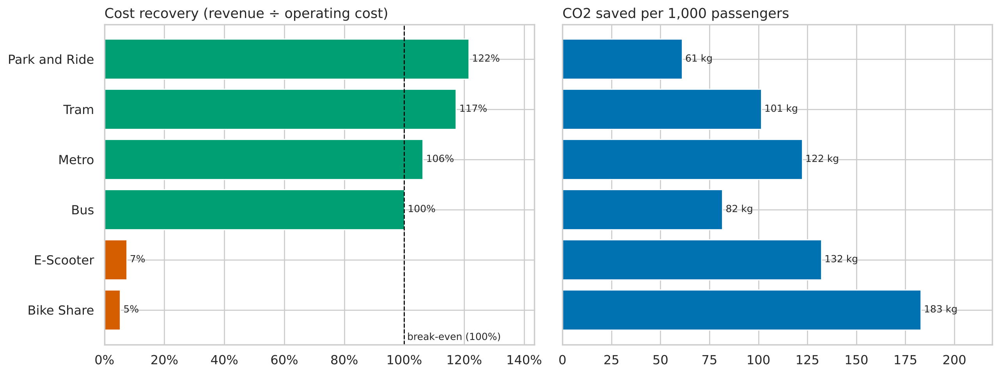
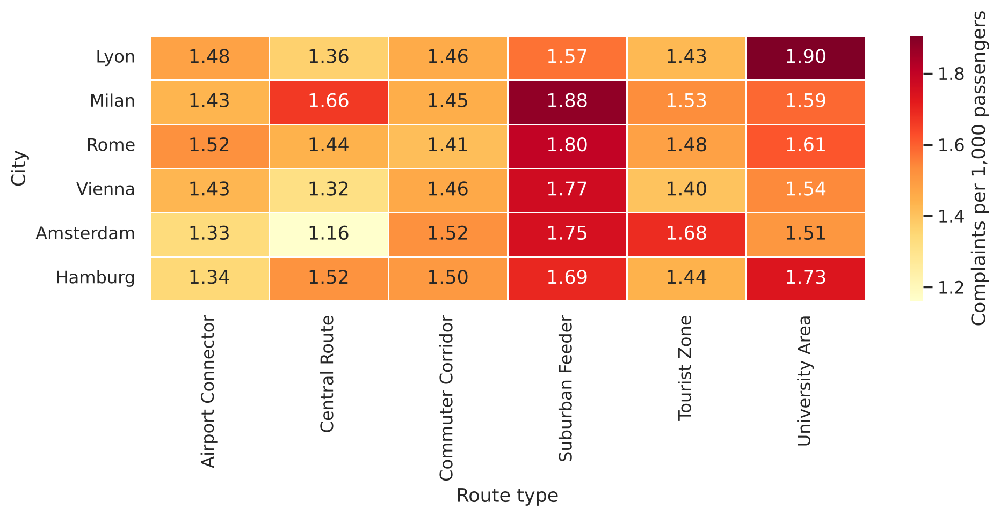
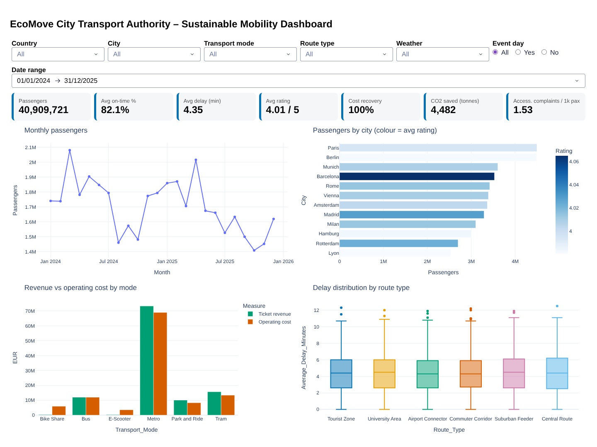
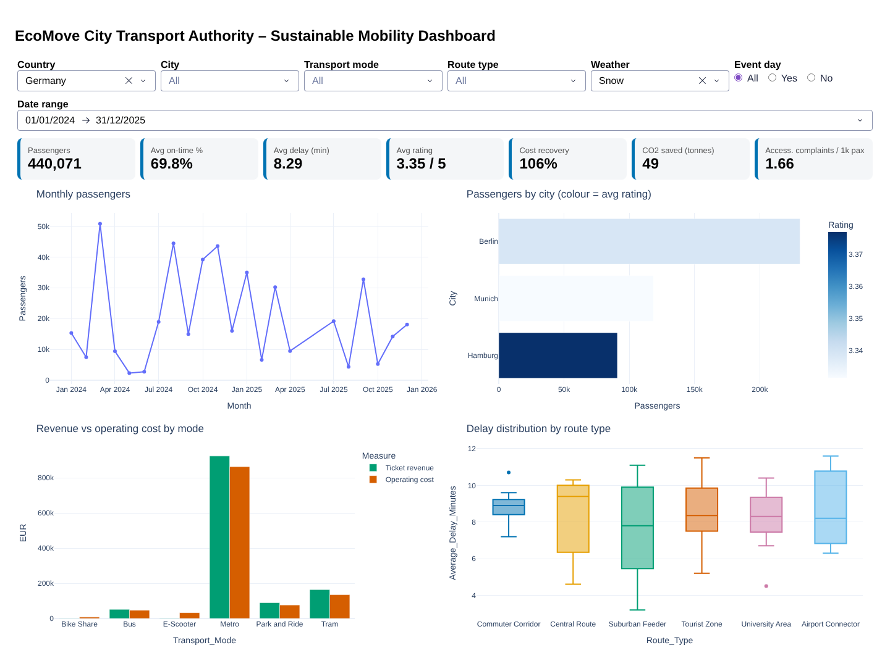

# EcoMove Mobility – Data Visualisation


A data visualisation investigation of public transport and shared mobility performance for the
**EcoMove City Transport Authority**, covering 12 cities in 6 European countries over 2024–2025.
The project combines six static visualisations with an interactive **Plotly Dash** dashboard to help
senior managers make decisions on route planning, reliability, sustainability, accessibility and investment.

> Created for the module **Data Visualisation (COM7021)** – MSc Data Science, Arden University Berlin.

---

## Contents

- [Dataset](#dataset)
- [Visualisations](#visualisations)
- [Interactive dashboard](#interactive-dashboard)
- [Key findings](#key-findings)
- [Getting started](#getting-started)
- [Project structure](#project-structure)
- [Tech stack](#tech-stack)
- [Author](#author)

---

## Dataset

| Item | Detail |
|---|---|
| Records | 5,000 daily operational records, 18 variables |
| Period | 1 January 2024 – 31 December 2025 |
| Coverage | 12 cities, 6 countries, 6 transport modes, 6 route types |
| Measures | Passengers, trips, delays, on-time %, revenue, operating cost, CO2 saved, energy use, customer rating, accessibility complaints |

**Preparation:** no missing values or duplicates were found. Dates stored as Excel serial numbers were
converted to datetime, and size-adjusted measures were derived (cost recovery %, complaints per 1,000
passengers, CO2 saved per passenger) so that large and small services can be compared fairly.

> The dataset is Arden University course material and is **not included** in this repository.

---

## Visualisations

| | |
|---|---|
| **Monthly passengers by transport mode** – time series | **Total passengers by city** – sorted comparison |
|  |  |
| **Correlation between the five key KPIs** – relationship | **Average delay by weather** – distribution |
|  |  |
| **Cost recovery and CO2 saved by mode** – performance indicators | **Accessibility complaint rate by route type** – heatmap |
|  |  |

All charts use the colour-blind-safe **Okabe–Ito** palette.

---

## Interactive dashboard

Built with **Plotly Dash**, following the principle *"overview first, zoom and filter, then details on demand"*.

- **Filters:** country, city, transport mode, route type, weather, event day and date range
- **KPI cards:** passengers, on-time %, average delay, rating, cost recovery, CO2 saved, complaints per 1,000 passengers
- **Linked charts:** monthly trend, passengers by city, revenue vs operating cost, delay by route type

| Default view | Filtered: Germany + Snow |
|---|---|
|  |  |

---

## Key findings

- **Demand:** Paris and Berlin are the busiest cities; Metro carries about 63% of all passengers. Total demand fell by 5% in 2025.
- **Reliability:** snow causes the longest delays (median 8.45 minutes) and cuts on-time performance to about 70%. Bus is the least punctual mode (74.9% on time).
- **Customer experience:** punctuality is the strongest driver of customer rating (r ≈ 0.80).
- **Finance vs environment:** Metro, Tram and Park and Ride cover their costs, while Bike Share and E-Scooter recover only 5–7%, yet save the most CO2 per passenger.
- **Accessibility:** Suburban Feeder routes have the highest complaint rates in almost every city.

---

## Getting started

```bash
# 1. Clone the repository
git clone https://github.com/ItsUgesh/ecomove-data-visualisation.git
cd ecomove-data-visualisation

# 2. Create and activate a virtual environment
python -m venv .venv
.venv\Scripts\activate        # Windows
# source .venv/bin/activate   # macOS / Linux

# 3. Install the dependencies
pip install -r requirements.txt
```

4. Place the dataset `5442_EcoMoveMobility.xlsx` in the project folder.
5. Open `EcoMove_Visualisation.ipynb` in Jupyter or VS Code and run all cells.
6. The final cell starts the dashboard at **http://127.0.0.1:8050**.

---

## Project structure

```
ecomove-data-visualisation/
├── EcoMove_Visualisation.ipynb   # full analysis, charts and dashboard
├── figures/                      # exported charts and dashboard screenshots
├── requirements.txt              # Python dependencies
├── .gitignore
└── README.md
```

---

## Tech stack

**Python** · **pandas** · **NumPy** · **Matplotlib** · **seaborn** · **Plotly** · **Dash** · **Jupyter**

---

## Author

**Ugesh Simkhada** – MSc Data Science student, Arden University Berlin

[Portfolio](https://ugeshsimkhada.com.np) · [GitHub](https://github.com/ItsUgesh)
